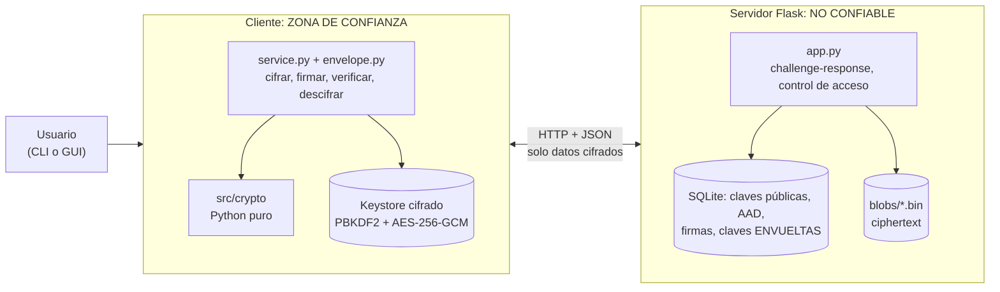

# Almacenamiento en la Nube con Cifrado Híbrido Zero-Trust

**ELC107 Criptografía y Seguridad - Proyecto 2 - Grupo F**
Universidad Autónoma Gabriel René Moreno (UAGRM) - Facultad de Ingeniería en Ciencias de la Computación y Telecomunicaciones (FICCT)

Plataforma de transferencia de archivos en la que **el cliente cifra todo localmente antes de subirlo**. El contenido se cifra con AES-256-GCM usando una clave de sesión aleatoria; esa clave se envuelve con RSA-OAEP para cada destinatario y el paquete se firma con RSA-PSS. **El servidor nunca conoce el texto claro, el nombre real de los archivos ni las claves de sesión o privadas.**

Toda la criptografía principal está **implementada desde cero en Python puro**: SHA-256, HMAC, PBKDF2, AES-256, GCM, aritmética RSA, Miller-Rabin, OAEP y PSS. No se usan librerías de "caja negra"; la librería `cryptography` aparece **solo en las pruebas**, para validar nuestras implementaciones de forma cruzada.

---

## Contenido

- [Características](#características)
- [Arquitectura](#arquitectura)
- [Primitivas implementadas desde cero](#primitivas-implementadas-desde-cero)
- [Modelo de seguridad](#modelo-de-seguridad)
- [Instalación rápida](#instalación-rápida)
- [Uso rápido](#uso-rápido)
- [Pruebas](#pruebas)
- [Rendimiento](#rendimiento)
- [Decisiones de diseño y limitaciones](#decisiones-de-diseño-y-limitaciones)
- [Estructura del proyecto](#estructura-del-proyecto)
- [Capturas](#capturas)
- [Integrantes](#integrantes)
- [Referencias](#referencias)

Guía paso a paso para Windows: **[MANUAL_DESPLIEGUE.md](MANUAL_DESPLIEGUE.md)**.

---

## Características

- **Cifrado híbrido en el cliente:** AES-256-GCM para el contenido (nonce de 96 bits, tag de 128 bits, AAD) y RSA-OAEP-SHA256 para la clave de sesión de cada destinatario.
- **Firma digital RSA-PSS** de cada archivo; la descarga verifica firma, metadatos y tag antes de entregar cualquier dato.
- **Compartir sin que el servidor vea la clave:** el dueño desenvuelve la clave de sesión localmente y la re-envuelve para el destinatario.
- **Login sin contraseñas:** challenge-response firmado con RSA-PSS; nonce de un solo uso que expira en 60 s (anti-replay).
- **Keystore local cifrado:** la clave privada se guarda cifrada con AES-256-GCM, con clave derivada de la passphrase mediante PBKDF2-HMAC-SHA256.
- **Directorio de claves públicas con huellas SHA-256** y *pinning* (fijado de huellas) en el cliente para detectar que el servidor sustituya una clave (MITM).
- **Nombres de archivo cifrados:** el nombre real y el tamaño original viajan dentro del contenido cifrado.
- **Dos interfaces:** línea de comandos (`grupof.py`) e interfaz gráfica Tkinter (`grupof_gui.py`) con un registro paso a paso de las operaciones criptográficas.
- **Demo de ataques** para la defensa en vivo, **benchmarks** con tablas y gráficos, y **vista del servidor comprometido** con análisis de entropía.
- Varios usuarios en la misma PC (`--user alice`, `--user bob`, cada uno con su keystore).

## Arquitectura



**Subida (resumen):**

1. El cliente genera una clave de sesión `K_s` de 256 bits y un nonce de 96 bits.
2. Cifra `{nombre real, tamaño} ‖ datos` con AES-256-GCM. La AAD es `{file_id, owner, timestamp, tamaño del ciphertext}`.
3. Envuelve `K_s` con RSA-OAEP para el dueño y para cada destinatario.
4. Firma con RSA-PSS el `SHA-256(ciphertext ‖ nonce ‖ tag ‖ AAD)`, con prefijos de longitud.
5. Envía solo el ciphertext, el nonce, el tag, la AAD, las claves envueltas, la firma y la huella.

**Descarga:** firma PSS → AAD → desenvolver con OAEP → verificar el tag GCM y descifrar. **Cualquier fallo aborta sin entregar datos.**

Diagramas completos (Mermaid y draw.io): [docs/](docs/README.md): [arquitectura](docs/arquitectura.md), [subida](docs/secuencia_subida.md), [descarga](docs/secuencia_descarga.md), [compartir](docs/secuencia_compartir.md).

## Primitivas implementadas desde cero

| Primitiva | Norma | Archivo | Validación en `tests/` |
|---|---|---|---|
| SHA-256 | FIPS 180-4 | `src/crypto/sha256.py` | Vectores NIST (incl. 1 millón de "a"), constantes derivadas de los primos, `cryptography` |
| HMAC-SHA256 | RFC 2104 / FIPS 198-1 | `src/crypto/hmac_sha256.py` | Los 7 casos de RFC 4231, `cryptography` |
| PBKDF2-HMAC-SHA256 | RFC 8018 | `src/crypto/kdf.py` | Vectores de RFC 7914, `cryptography` |
| AES-256 (S-box calculada, KeyExpansion, SubBytes, ShiftRows, MixColumns, AddRoundKey) | FIPS 197 | `src/crypto/aes.py` | FIPS 197 Apéndices A, B y C; versión didáctica = optimizada; `cryptography` |
| GCM (GCTR, GHASH, multiplicación en GF(2¹²⁸)) | NIST SP 800-38D | `src/crypto/gcm.py` | Casos de McGrew-Viega 1-4 y 13-18, `cryptography` en ambos sentidos |
| Aritmética modular (square-and-multiply, Euclides extendido) | - | `src/crypto/arith.py` | Comparación con `pow` nativo (solo en tests) |
| Miller-Rabin + criba, generación de primos | FIPS 186-5 A.1.3 | `src/crypto/primes.py` | Primos de Mersenne, 19 números de Carmichael, pseudoprimo fuerte |
| RSA (claves 2048/3072, CRT, cegado, anti-Bellcore) | RFC 8017 §5, FIPS 186-5 | `src/crypto/rsa_core.py` | Consistencia, CRT = sin CRT, ataque de Bellcore reproducido |
| MGF1, RSA-OAEP | RFC 8017 §7.1 | `src/crypto/mgf.py`, `oaep.py` | Cifrar/descifrar cruzado con `cryptography` |
| RSA-PSS | RFC 8017 §8.1 / §9.1 | `src/crypto/pss.py` | Firmar/verificar cruzado con `cryptography` (incl. módulo de 2049 bits) |
| Formato de claves propio (TLV + PEM-like) y huellas | - | `src/crypto/encoding.py` | Ida y vuelta, detección de alteraciones |

Una prueba de política ([tests/test_politica_sin_cajas_negras.py](tests/test_politica_sin_cajas_negras.py)) analiza el código de `src/` y **falla si encuentra** `hashlib`, `hmac`, `cryptography` u otras librerías criptográficas, o un `pow(b, e, m)` en `src/crypto/`.

## Modelo de seguridad

### Qué protege

| Ataque | Defensa | Demo |
|---|---|---|
| Alterar 1 bit del ciphertext | Firma RSA-PSS y tag AES-GCM | a) |
| Alterar la AAD / metadatos | Firma RSA-PSS y tag AES-GCM (la AAD está autenticada) | b) |
| Firma falsificada o hecha con otra clave | Verificación PSS con la clave pública fijada del dueño; el servidor también la verifica | c) |
| Usuario no autorizado | El servidor solo entrega a cada uno su clave envuelta (404 al resto); sin la clave privada no se desenvuelve OAEP | d) |
| Replay del login | Nonce de un solo uso, borrado antes de verificar la firma; expira en 60 s | e) |
| Servidor comprometido / robo del disco | Solo hay bytes cifrados (entropía ≈ 8 bits/byte), claves públicas y claves envueltas | f) |
| El servidor sustituye una clave pública (MITM) | Huella SHA-256 recalculada localmente y fijada; verificación fuera de banda | g) |
| Robo del keystore | Clave privada cifrada con AES-256-GCM; clave derivada con PBKDF2 y sal aleatoria | - |
| Robo de la base de datos de sesiones | El servidor guarda solo el SHA-256 de cada token | - |
| Registrar la clave pública de otro a nombre propio | Prueba de posesión: el registro exige una firma con la clave privada | - |

### Qué conoce el servidor (inevitable para el control de acceso)

El servidor **sí conoce**:

- quién es el **dueño** de cada archivo;
- **con quién se comparte** (destinatarios);
- **cuándo** se subió y compartió;
- el **tamaño del ciphertext** (aproximadamente el del archivo original).

Esa información es necesaria para decidir quién puede descargar qué y para entregar a cada usuario su propia clave envuelta. En cambio, **no conoce el nombre real del archivo** (va cifrado dentro del contenido), ni su contenido, ni ninguna clave de sesión o privada. Se puede comprobar con:

```powershell
python -m src.server.compromised_view --data-dir server_data
```

## Instalación rápida

Requisitos: Windows 10/11, Python 3.11 o superior (probado con 3.14) y Git.

```powershell
git clone <URL-del-repositorio> ELC107-Proyecto2-GrupoF
cd ELC107-Proyecto2-GrupoF
py -m venv .venv
.\.venv\Scripts\Activate.ps1
python -m pip install -r requirements-dev.txt     # o requirements.txt si no se van a correr las pruebas
python -m pytest -m "not slow"                    # verificación (~1 min)
```

Detalles, opciones y solución de problemas: [MANUAL_DESPLIEGUE.md](MANUAL_DESPLIEGUE.md).

## Uso rápido

```powershell
# Terminal 1: servidor (http://127.0.0.1:5000, datos en .\server_data)
python servidor.py

# Terminal 2: alice y bob (10.000 iteraciones SOLO para demostración; el valor por defecto es 100.000)
python grupof.py --user alice keygen --kdf-iters 10000
python grupof.py --user alice register
python grupof.py --user alice login
python grupof.py --user bob keygen --kdf-iters 10000
python grupof.py --user bob register
python grupof.py --user bob login

"Acta de la reunión del Grupo F" | Set-Content -Encoding utf8 memo.txt
python grupof.py --user alice upload memo.txt --share-with bob
python grupof.py --user alice list
python grupof.py --user bob download <file_id> --out descargas
python grupof.py --user bob verify <file_id>

# Interfaz gráfica (se pueden abrir varias ventanas: alice y bob a la vez)
python grupof_gui.py

# Demo de ataques (no necesita el servidor) y benchmarks
python demo\demo_ataques.py
python benchmarks\bench.py
```

Comandos de la CLI: `keygen`, `register`, `login`, `upload`, `download`, `share`, `list`, `verify` y `fingerprint`. Ver `python grupof.py --help`.

## Pruebas

```powershell
python -m pytest                  # suite completa: 195 pruebas (~2 min)
python -m pytest -m "not slow"    # sin las pruebas lentas (~1 min)
python -m pytest tests/test_gcm.py -v
```

| Archivo | Qué prueba |
|---|---|
| `test_sha256.py`, `test_hmac.py`, `test_kdf.py` | Vectores NIST/RFC y validación cruzada |
| `test_aes.py`, `test_gcm.py` | FIPS 197, McGrew-Viega, alteraciones, validación cruzada |
| `test_primes.py`, `test_rsa.py` | Carmichael, Miller-Rabin, CRT, ataque de Bellcore |
| `test_oaep.py`, `test_pss.py`, `test_encoding.py` | Interoperabilidad con `cryptography` en ambos sentidos |
| `test_politica_sin_cajas_negras.py` | Que `src/` no use librerías criptográficas |
| `test_server.py` | Registro, anti-replay, expiración, control de acceso, servidor comprometido |
| `test_keystore.py`, `test_e2e.py`, `test_cli.py`, `test_gui.py` | Cliente, flujo completo alice/bob/carol y ataques |
| `test_demo_y_bench.py`, `test_reset_demo.py` | Demo, benchmarks y script de limpieza |

## Rendimiento

Medido en la PC del grupo (Python 3.14, Windows 11). Detalle completo, CSV y gráficos: [benchmarks/results/RESULTADOS.md](benchmarks/results/RESULTADOS.md).

| Operación | Resultado |
|---|---|
| Generar claves RSA-2048 / RSA-3072 | ≈ 0,7-0,9 s / ≈ 2,5 s |
| Descifrado RSA con CRT frente a sin CRT | 3,6x más rápido (2048 bits) |
| AES-256-GCM | ≈ 780 KB/s (estable de 10 KB a 5 MB) |
| PBKDF2: 10.000 / 100.000 iteraciones | ≈ 2,7 s / ≈ 26 s |
| Entropía del ciphertext (1 MB) | 7,9998 bits/byte (texto claro: ≈ 4,35) |

## Decisiones de diseño y limitaciones

**Decisiones:**

- **PBKDF2 con 100.000 iteraciones por defecto.** OWASP recomienda 600.000 para PBKDF2-HMAC-SHA256, pero en Python puro serían unos 2,5 minutos por desbloqueo. Se redujo por ese costo y queda documentado en `src/crypto/kdf.py`. El número de iteraciones se guarda dentro de cada keystore, así que puede subirse sin romper los existentes (`keygen --kdf-iters`). Las cuentas de la demo usan 10.000 **solo para demostración**.
- **Separación de dominios y prefijos de longitud** en todo lo que se firma (registro, login, archivo), para que una firma de un contexto no sirva en otro.
- **RSA:** `d = e⁻¹ mod λ(n)`, `|p − q| > 2^(n/2−100)`. Se descifra con CRT (Garner) y cegado, y cada firma se verifica antes de devolverla (contramedida contra el ataque de Bellcore).
- **OAEP** devuelve un único error genérico y recorre siempre todo el bloque (contra el oráculo de Manger). Las comparaciones de tags y hashes son en tiempo constante.
- **Material sensible en `bytearray`**, sobrescrito con ceros tras usarse: passphrase, claves derivadas y claves de sesión.

**Limitaciones conocidas:**

- **Borrado de memoria en Python:** los `bytes`, `str` e `int` son inmutables y el recolector de basura decide cuándo libera su memoria. El borrado con ceros reduce la exposición pero no garantiza que no queden copias; en particular, los enteros de la clave RSA no pueden borrarse de forma fiable.
- **Canales laterales:** AES usa T-tables (accesos a memoria dependientes de la clave) y la aritmética de Python no es de tiempo constante. En producción se usarían AES-NI y bibliotecas de tiempo constante.
- **Metadatos:** el servidor conoce dueño, destinatarios, fechas y tamaño (ver [Modelo de seguridad](#modelo-de-seguridad)).
- **Confianza en las claves:** la primera clave vista de un remitente se fija por TOFU (*trust on first use*). La seguridad completa exige comparar huellas fuera de banda (`fingerprint --trust`).
- **No hay revocación** de un archivo ya compartido ni rotación de claves de usuario.
- **El token de sesión** se guarda en claro en el keystore. Dura 15 minutos y no permite descifrar nada.
- **Transporte:** el prototipo usa HTTP local. En un despliegue real se añadiría TLS (aunque el contenido ya viaja cifrado de extremo a extremo).

## Estructura del proyecto

```
ELC107-Proyecto2-GrupoF/
├─ src/
│  ├─ crypto/      SHA-256, HMAC, PBKDF2, AES, GCM, primos, RSA, MGF1, OAEP, PSS, formato de claves
│  ├─ client/      cli.py, gui.py, service.py, envelope.py, keystore.py, api_client.py
│  ├─ server/      app.py (Flask), storage.py (SQLite + blobs), compromised_view.py
│  ├─ protocol.py  mensajes firmados, AAD canónica, encabezado interno cifrado
│  └─ sample_data.py
├─ tests/          195 pruebas (vectores oficiales, validación cruzada, e2e, GUI)
├─ benchmarks/     bench.py y results/ (CSV, PNG, RESULTADOS.md)
├─ demo/           demo_ataques.py
├─ docs/           diagramas Mermaid, drawio/ y capturas/
├─ scripts/        reset_demo.py (limpieza antes de grabar la demo)
├─ grupof.py       atajo de la CLI
├─ grupof_gui.py   atajo de la GUI
├─ servidor.py     atajo del servidor
├─ requirements.txt / requirements-dev.txt
├─ README.md
└─ MANUAL_DESPLIEGUE.md
```

## Capturas

> Pendiente: guardar las imágenes en [docs/capturas/](docs/capturas/README.md) con estos nombres.

**Interfaz gráfica: ventana principal y registro de operaciones**


**Registro paso a paso al subir un archivo**


**Diálogo de fallo de seguridad (archivo alterado)**


**alice y bob en dos ventanas**


**Flujo completo por línea de comandos**


**Demo de ataques: resumen**


**Entropía: texto claro vs ciphertext**


**Vista del servidor comprometido**


**Pruebas automatizadas**


## Integrantes

| Nombre completo | Registro | Rol / aporte principal |
|---|---|---|
| [Nombre Apellido 1] | [Registro 1] | [Rol 1] |
| [Nombre Apellido 2] | [Registro 2] | [Rol 2] |
| [Nombre Apellido 3] | [Registro 3] | [Rol 3] |
| [Nombre Apellido 4] | [Registro 4] | [Rol 4] |

Docente: [Nombre del docente] - Gestión: [Semestre/Año]

## Referencias

- NIST FIPS 180-4, *Secure Hash Standard (SHS)*, 2015.
- NIST FIPS 197, *Advanced Encryption Standard (AES)*, 2001 (actualizado 2023).
- NIST SP 800-38D, *Recommendation for Block Cipher Modes of Operation: Galois/Counter Mode (GCM) and GMAC*, 2007.
- NIST FIPS 186-5, *Digital Signature Standard (DSS)*, 2023.
- RFC 2104, *HMAC: Keyed-Hashing for Message Authentication*; RFC 4231, *Identifiers and Test Vectors for HMAC-SHA-224, -256, -384 and -512*.
- RFC 8018, *PKCS #5: Password-Based Cryptography Specification v2.1*; RFC 7914 (vectores de PBKDF2-HMAC-SHA256).
- RFC 8017, *PKCS #1: RSA Cryptography Specifications v2.2* (OAEP, PSS, MGF1, CRT).
- D. McGrew y J. Viega, *The Galois/Counter Mode of Operation (GCM)*, 2005 (vectores de prueba).
- J. Sorenson y J. Webster, *Strong pseudoprimes to twelve prime bases*, 2015 (bases deterministas de Miller-Rabin).
- D. Boneh, R. DeMillo y R. Lipton, *On the Importance of Checking Cryptographic Protocols for Faults*, 1997 (ataque de Bellcore).
- J. Manger, *A Chosen Ciphertext Attack on RSA OAEP*, CRYPTO 2001.
- OWASP, *Password Storage Cheat Sheet* (iteraciones recomendadas para PBKDF2).
