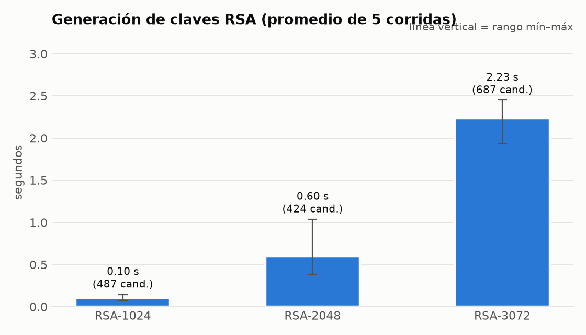
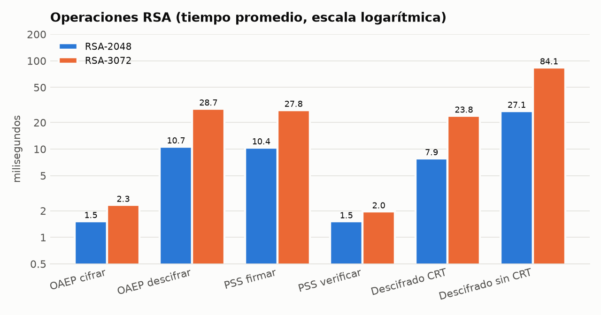
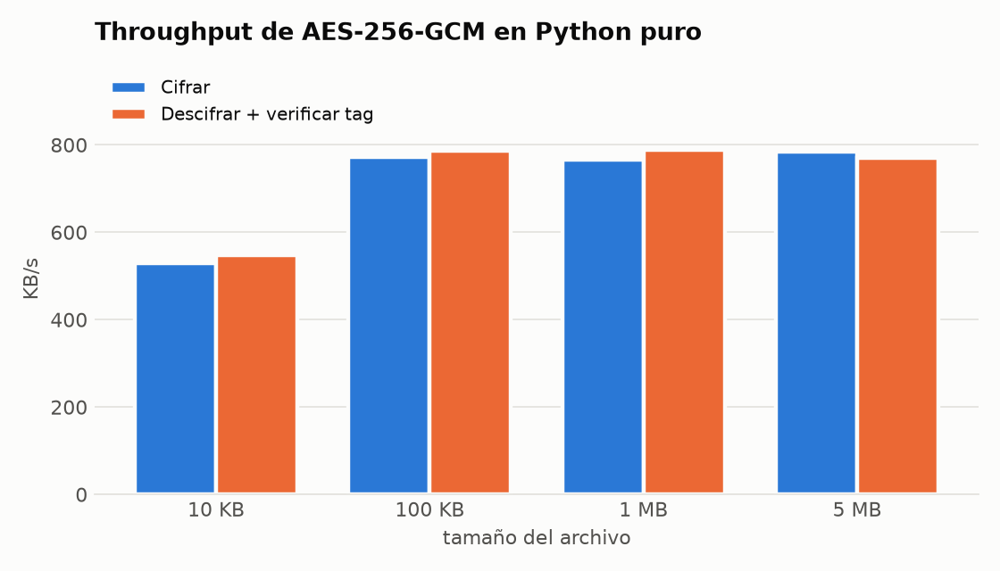
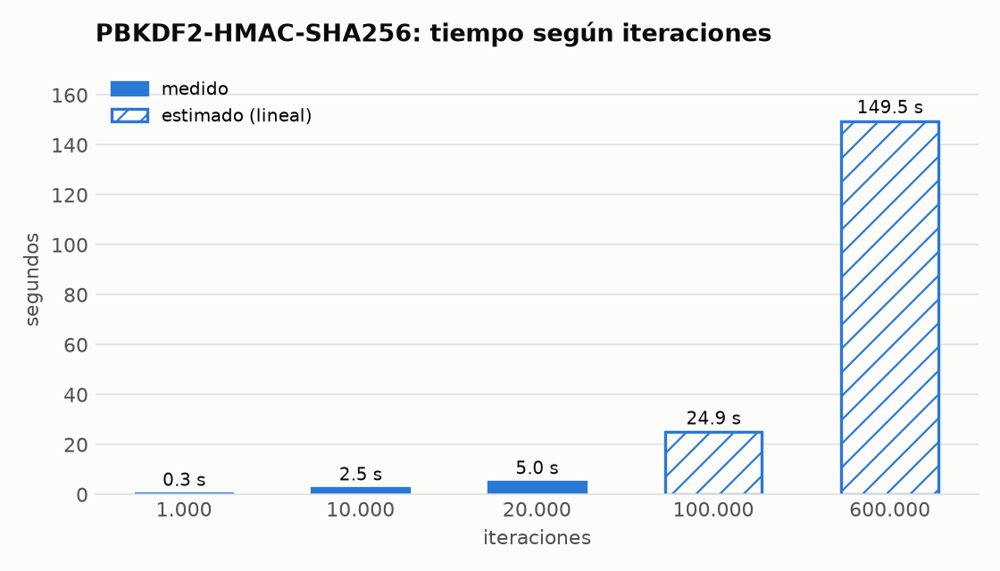
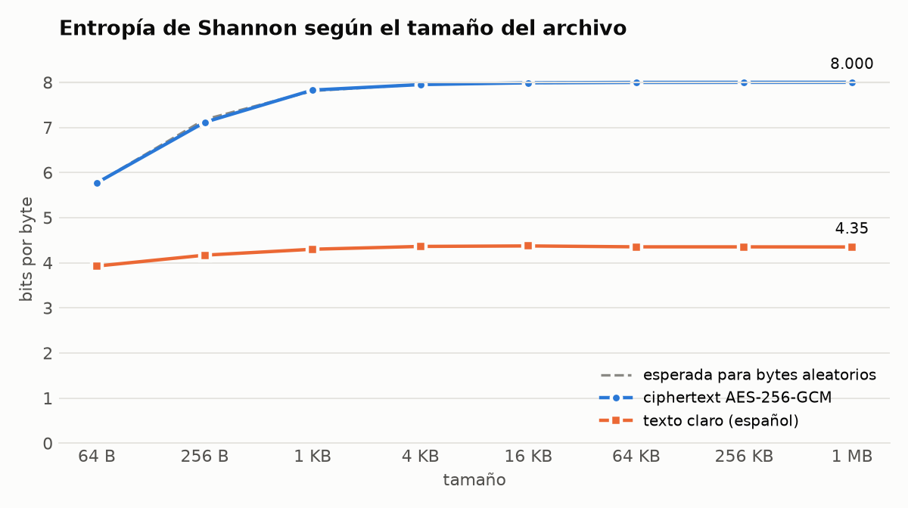

# Resultados de benchmarks - Proyecto 2 ELC107 (Grupo F)

- Fecha: 2026-11-23 18:30
- Python 3.14.10 (CPython), Windows 11, AMD64
- Procesador: Intel64 Family 6 Model 140 Stepping 1, GenuineIntel
- Duración total: 47 s
- Todas las primitivas son implementaciones propias en Python puro (sin librerías criptográficas).

## 1. Generación de claves RSA

| Tamaño | Corridas | Promedio (s) | Desv. (s) | Mín (s) | Máx (s) | Candidatos (prom.) | Llegan a Miller-Rabin (prom.) |
|---|---|---|---|---|---|---|---|
| RSA-1024 | 5 | 0.10 | 0.03 | 0.08 | 0.15 | 487 | 66 |
| RSA-2048 | 5 | 0.60 | 0.27 | 0.38 | 1.04 | 424 | 68 |
| RSA-3072 | 5 | 2.23 | 0.27 | 1.94 | 2.45 | 687 | 100 |

La criba por primos < 2000 descarta la mayoría de los candidatos sin ninguna exponenciación modular.

## 2. Operaciones RSA

| Tamaño | Operación | Repeticiones | Promedio (ms) | Mín (ms) |
|---|---|---|---|---|
| RSA-2048 | OAEP cifrar | 20 | 1.52 | 1.48 |
| RSA-2048 | OAEP descifrar | 20 | 10.68 | 10.00 |
| RSA-2048 | PSS firmar | 20 | 10.42 | 9.91 |
| RSA-2048 | PSS verificar | 20 | 1.52 | 1.26 |
| RSA-2048 | Descifrado CRT | 20 | 7.85 | 7.53 |
| RSA-2048 | Descifrado sin CRT | 20 | 27.08 | 26.21 |
| RSA-3072 | OAEP cifrar | 10 | 2.33 | 2.30 |
| RSA-3072 | OAEP descifrar | 10 | 28.69 | 27.23 |
| RSA-3072 | PSS firmar | 10 | 27.77 | 26.93 |
| RSA-3072 | PSS verificar | 10 | 1.96 | 1.86 |
| RSA-3072 | Descifrado CRT | 10 | 23.84 | 22.91 |
| RSA-3072 | Descifrado sin CRT | 10 | 84.12 | 80.52 |

- RSA-2048: el CRT acelera el descifrado **3.4x**.
- RSA-3072: el CRT acelera el descifrado **3.5x**.
- Cifrar/verificar es rápido porque e = 65537 tiene solo 17 bits.

## 3. Throughput de AES-256-GCM y SHA-256

| Tamaño | Cifrar (s) | Cifrar (KB/s) | Descifrar (s) | Descifrar (KB/s) |
|---|---|---|---|---|
| 10 KB | 0.019 | 529 | 0.018 | 549 |
| 100 KB | 0.130 | 772 | 0.127 | 787 |
| 1 MB | 1.338 | 765 | 1.299 | 788 |
| 5 MB | 6.534 | 784 | 6.641 | 771 |

SHA-256 (1 MB): 2.044 s = 501 KB/s.

## 4. PBKDF2-HMAC-SHA256

| Iteraciones | Tiempo (s) | Tipo |
|---|---|---|
| 1.000 | 0.25 | medido |
| 10.000 | 2.47 | medido |
| 20.000 | 4.99 | medido |
| 100.000 | 24.92 | estimado |
| 600.000 | 149.49 | estimado |

100.000 es el valor por defecto del sistema; OWASP recomienda 600.000. 10.000 se usa SOLO en la demo.

## 5. Entropía según el tamaño del archivo

| Tamaño | Texto claro (bits/byte) | Ciphertext (bits/byte) | Esperada aleatoria | Imprimibles texto | Imprimibles ciphertext |
|---|---|---|---|---|---|
| 64 B | 3.9257 | 5.7695 | 5.7657 | 90.6% | 39.1% |
| 256 B | 4.1671 | 7.1140 | 7.1750 | 94.5% | 38.7% |
| 1 KB | 4.2985 | 7.8277 | 7.8088 | 96.5% | 40.7% |
| 4 KB | 4.3610 | 7.9496 | 7.9546 | 95.9% | 37.5% |
| 16 KB | 4.3721 | 7.9891 | 7.9887 | 96.1% | 37.6% |
| 64 KB | 4.3518 | 7.9975 | 7.9972 | 96.1% | 38.1% |
| 256 KB | 4.3512 | 7.9992 | 7.9993 | 96.1% | 38.4% |
| 1 MB | 4.3491 | 7.9998 | 7.9998 | 96.2% | 38.3% |

Con muestras pequeñas la entropía medida es menor aunque los bytes sean perfectamente aleatorios
(con n bytes hay a lo sumo n valores distintos). El ciphertext coincide con el valor esperado
exacto para datos aleatorios del mismo tamaño (conteos Binomial(n, 1/256)).

## Gráficos

