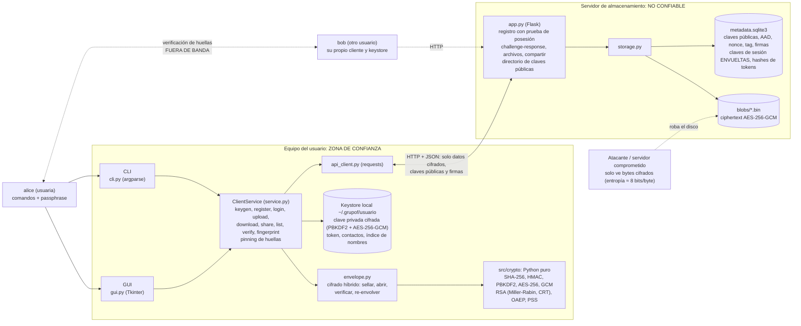
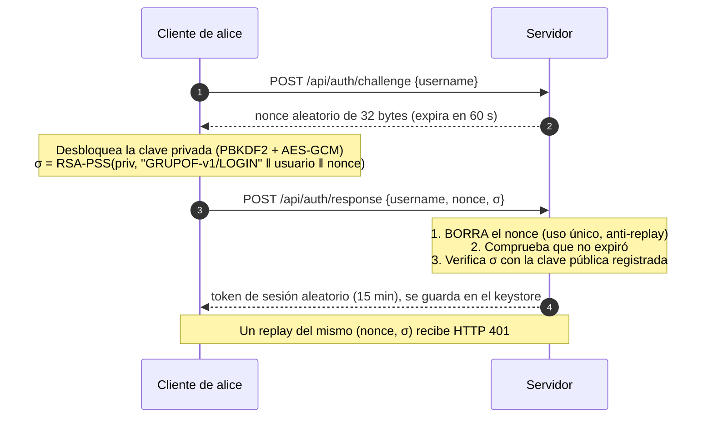

# Arquitectura del sistema

El sistema separa dos zonas de confianza:

- **Equipo del usuario (zona de confianza):** toda la criptografía ocurre aquí. El cliente (CLI o GUI) genera las claves, cifra, firma, descifra y verifica. La clave privada vive en un keystore local cifrado con una clave derivada de la passphrase.
- **Servidor de almacenamiento (no confiable):** solo guarda y entrega bytes cifrados, claves públicas, firmas y claves de sesión *envueltas*. No posee ninguna clave privada ni de sesión. Aun así aplica controles propios (defensa en profundidad): login sin contraseñas por challenge-response, verificación de firmas al subir y control de acceso por destinatario.

Versión editable para el informe: [drawio/arquitectura.drawio](drawio/arquitectura.drawio).

## Qué guarda cada lado

| Dato | Cliente | Servidor |
|---|---|---|
| Clave privada RSA | Sí, cifrada en el keystore (PBKDF2 + AES-256-GCM) | **Nunca** |
| Clave de sesión AES-256 en claro | Solo en memoria durante la operación, luego se borra | **Nunca** |
| Clave de sesión envuelta (RSA-OAEP) | Se recibe la propia | Una por destinatario |
| Texto claro y nombre real del archivo | Sí | **Nunca** (el nombre va cifrado dentro del contenido) |
| Ciphertext, nonce, tag, firma | Se generan | Se guardan |
| AAD: file_id, dueño, fecha, tamaño del ciphertext | Se genera | Visible (autenticada, no cifrada) |
| Quién comparte con quién | Sí | Visible (necesario para el control de acceso) |
| Token de sesión | En el keystore (15 min) | Solo su SHA-256 |

## Login sin contraseñas (challenge-response)

## Módulos

| Módulo | Responsabilidad |
|---|---|
| `src/crypto/` | Primitivas criptográficas propias (ver tabla en el README) |
| `src/protocol.py` | Bytes exactos que se firman (separación de dominios, prefijos de longitud), AAD canónica, encabezado interno cifrado |
| `src/client/envelope.py` | Cifrado híbrido del archivo: sellar, abrir, verificar, re-envolver |
| `src/client/service.py` | Lógica de cada comando y confianza en claves públicas (pinning) |
| `src/client/keystore.py` | Keystore local cifrado, sesión, contactos, índice de nombres |
| `src/client/cli.py`, `gui.py` | Interfaces de línea de comandos y gráfica (sin criptografía propia) |
| `src/server/app.py` | API Flask: registro, challenge-response, archivos, compartir |
| `src/server/storage.py` | SQLite + blobs en disco |
| `src/server/compromised_view.py` | Vista del atacante que roba el disco del servidor |
