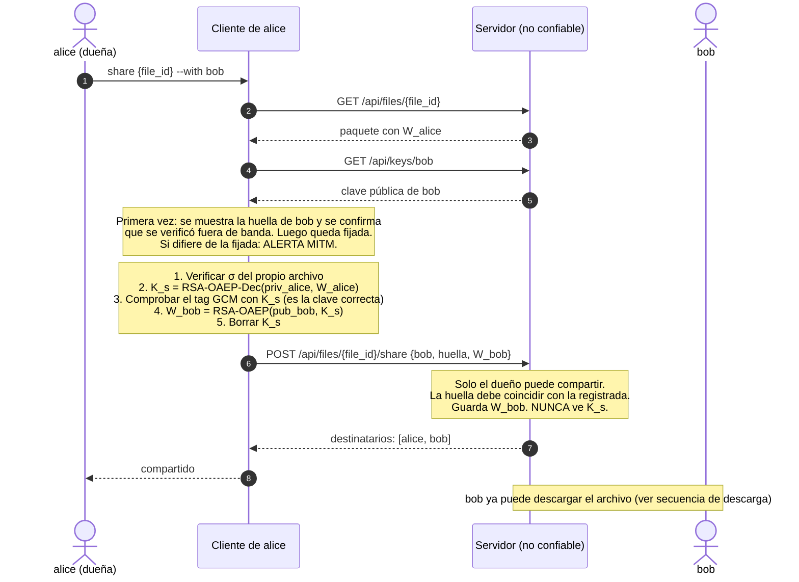

# Secuencia de compartir (re-envoltura local de la clave de sesión)

alice comparte con bob un archivo que ya subió. El archivo **no se vuelve a cifrar**: alice desenvuelve localmente la clave de sesión y la envuelve de nuevo con la clave pública de bob. El servidor nunca ve la clave de sesión.

Versión editable para el informe: [drawio/secuencia_compartir.drawio](drawio/secuencia_compartir.drawio).

## Detalles

- **Por qué se verifica el tag antes de re-envolver:** si alguien alterara `W_alice` en el servidor, OAEP fallaría. Pero el tag GCM garantiza además que la clave obtenida es exactamente la que autentica este archivo, así que nunca se comparte una clave equivocada.
- **Por qué importa la huella:** si el servidor entregara su propia clave pública en lugar de la de bob, alice envolvería K_s para el atacante. El *pinning* de huellas y la verificación fuera de banda lo impiden (ataque g de la demo).
- **Limitación:** dejar de compartir no está implementado. Revocar el acceso de verdad exigiría volver a cifrar el archivo con una K_s nueva, porque bob pudo haber guardado la anterior.
- **Código:** `src/client/envelope.py::rewrap_for`, `src/client/service.py::share`, `src/server/app.py::share`.
