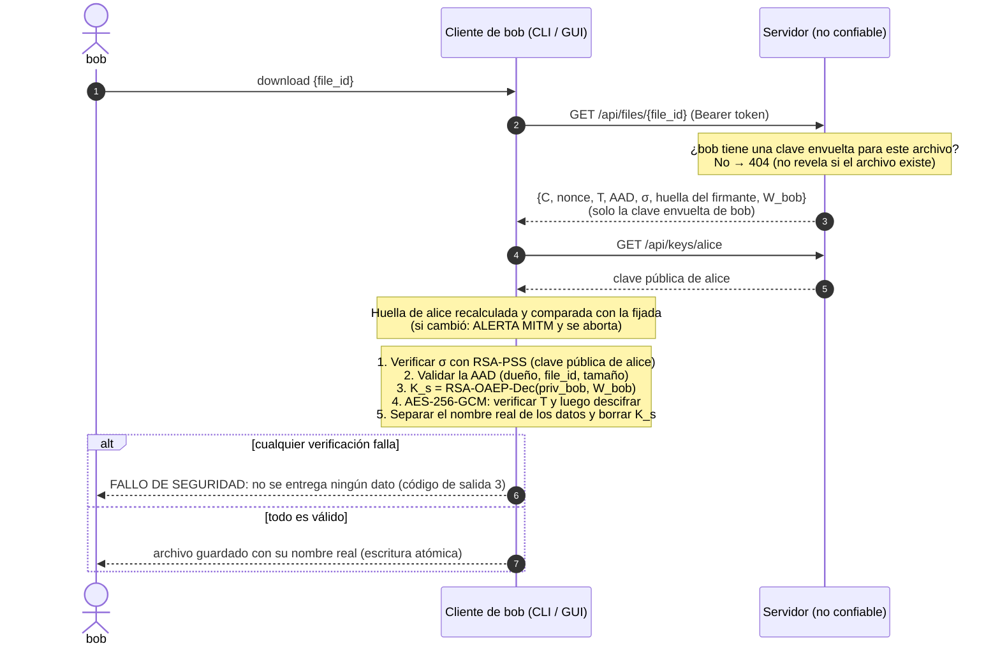

# Secuencia de descarga (verificar antes de entregar)

bob descarga el archivo que alice compartió con él. El orden de las verificaciones importa: **ante cualquier fallo se aborta sin entregar ni un byte** de texto claro.

Versión editable para el informe: [drawio/secuencia_descarga.drawio](drawio/secuencia_descarga.drawio).

## Qué detiene cada verificación

| Paso | Si falla | Ataque que detiene |
|---|---|---|
| Huella del dueño = fijada | `TrustError` (alerta MITM) | El servidor sustituye la clave pública del dueño |
| Firma RSA-PSS | `PackageError("firma")` | Alterar ciphertext, nonce, tag o AAD; firmar con otra clave |
| Coherencia de la AAD | `PackageError("metadatos")` | Entregar el paquete de otro archivo |
| RSA-OAEP | `PackageError("clave de sesión")` | Usuario no autorizado con un paquete robado |
| Tag AES-GCM | `PackageError("integridad")` | Cualquier alteración del ciphertext o la AAD (aun sin firma) |

- AES-GCM compara el tag en **tiempo constante** y *antes* de producir texto claro (SP 800-38D §7.2).
- El archivo se escribe primero como `.part` y se renombra solo al final, así que nunca queda un archivo a medias.
- El nombre recibido se sanea (`..\..\evil.dll` se guarda como `evil.dll`; nombres reservados de Windows como `CON` reciben un prefijo).
- **Código:** `src/client/envelope.py::open_package`, `src/client/service.py::download` y `save`.
