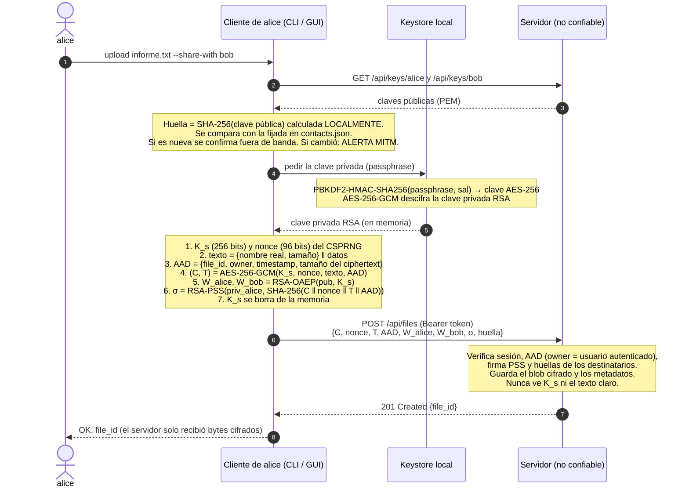

# Secuencia de subida (cifrado híbrido en el cliente)

alice sube `informe.txt` y lo comparte con bob en el mismo paso. Todo el cifrado ocurre en el cliente: el servidor solo recibe bytes cifrados.

Versión editable para el informe: [drawio/secuencia_subida.drawio](drawio/secuencia_subida.drawio).

## Detalles

- **Clave de sesión nueva por archivo:** cada archivo usa su propia K_s y su propio nonce, así que la reutilización de (clave, nonce) en GCM es prácticamente imposible.
- **Nombre del archivo cifrado:** el nombre real y el tamaño original van en un encabezado interno *dentro* del texto que se cifra. La AAD solo lleva lo que el servidor necesita para el control de acceso.
- **Qué se firma:** `SHA-256("GRUPOF-v1/FILE" ‖ LP(C) ‖ LP(nonce) ‖ LP(T) ‖ LP(AAD))`, donde LP antepone la longitud en 8 bytes. Sin los prefijos, bytes del final de un campo podrían "moverse" al siguiente y producir otra tupla con la misma firma.
- **Defensa en profundidad:** el servidor también verifica la firma y que la AAD diga que el dueño es el usuario autenticado. Un usuario no puede subir un archivo "a nombre de" otro.
- **Código:** `src/client/envelope.py::seal`, `src/client/service.py::upload`, `src/server/app.py::upload`.
